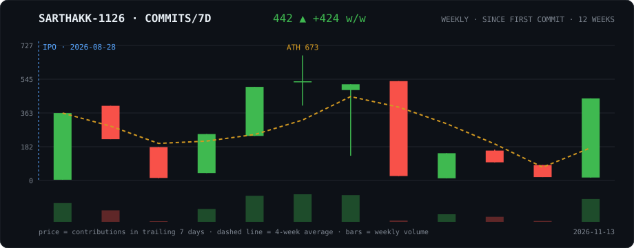
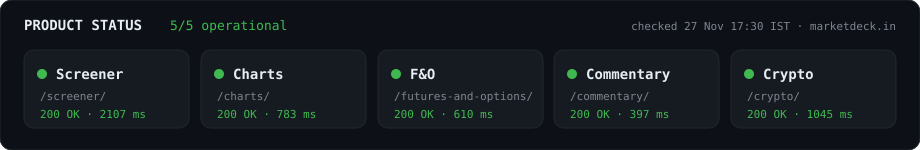

  

  
   
  My commit history, drawn as a stock chart. Price = contributions in the trailing 7 days. One candle per week: green if the week ended higher than it began, red if lower. Volume bars = weekly total. Redrawn twice a day by a <a href="scripts/profile_art.py">small Python script</a>.

  
   
  Live status of the MarketDeck pages, checked from GitHub's servers on every redraw.

## Who I am

I study and build at the point where finance meets software. BBA in Finance from Amity University, with a focus on quantitative finance, financial research, Python and markets. Based in Lucknow, India.

I got into quant because I wanted to take an idea, look at the evidence and find out whether it actually worked. Doing that was harder than it should have been, so my co-founder [Prateek Singh](https://github.com/prateeksingh24) and I started building the tools we wanted ourselves.

## What I'm building

**[MarketDeck](https://marketdeck.in)**: a research and education platform for Indian markets. Company fundamentals with the source behind each number, charting, derivatives analytics, valuation tools and interactive learning. We show data, not advice.

I run it as a small software factory: narrow, deterministic Python products, shipped quickly with AI coding agents, with a human reviewing every release.

## How I work

- Boring and deterministic first. An LLM only where plain logic can't do the job.
- Every number should be traceable to where it came from and what it assumes.
- Small releases, tests, a rollback plan.

## Stack

## Find me

[marketdeck.in](https://marketdeck.in) · [About MarketDeck](https://marketdeck.in/about/) · <!-- add LinkedIn and X links here -->
